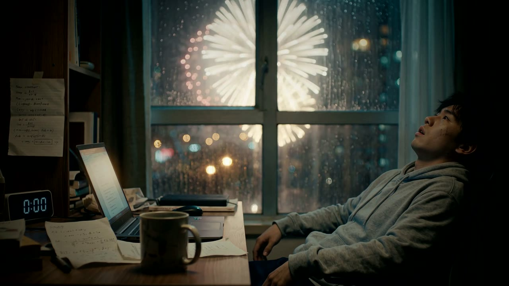

# lumiere

[English](README.md) | **中文**

完整版在 B 站：（发布后补上链接）

一个开放的视频风格手册，取名自发明电影的卢米埃尔兄弟。

每种风格都是一份完整、可复用的配方，包括：
- 关键词和参考片
- 情绪弧线和分镜语法
- 画面和声音设计
- 用过的提示词原文
- 踩过的坑
- 一份能直接渲染出片的模板

目标是：下次做同一种风格的视频时，从上次学到的所有东西开始，而不是从零开始。

## 风格索引

| 风格 | 一句话 | 代表作 |
|---|---|---|
| [screen-life-singularity](styles/screen-life-singularity/STYLE.zh.md) | 伪录屏电影风：镜头贴着屏幕拍，AI 接管电脑解决一个人类没解决的问题，内容是真的 | SINGULARITY（2:52，4K） |

## 每个风格文件夹里有什么

| 文件 | 内容 |
|---|---|
| `STYLE.md` | 关键词、参考片、情绪弧线、分镜语法、画面和声音配方、成本 |
| `LESSONS.md` | 哪里出了错、审片时被指出的问题、下次一开始就该怎么做 |
| `prompts/` | AI 配乐、音效、图片、视频的提示词原文，以及每条的效果说明 |
| `template/` | 能渲染出片的可复用代码和脚本 |
| `credits.md` | 素材来源、许可和署名 |

所有文档以英文为主，中文版是同目录下的 `*.zh.md`。

## 通用清单

- [出片前自检](checklists/before-render.zh.md)
- [发布前检查](checklists/before-publish.zh.md)

## 贡献一种风格

从 [`styles/_template/`](styles/_template/) 开始，并阅读 [CONTRIBUTING.md](CONTRIBUTING.md)。踩坑记录是最值钱的部分，所以先写 `LESSONS.md`。

## 许可

文档采用 CC BY 4.0，代码采用 MIT，见 [LICENSE](LICENSE)。第三方素材保留各自的许可，列在每种风格的 `credits.md` 里。

---

第一种风格由 Claude（Opus 5.5）在 [CoreSpeed](https://corespeed.io) 的 Agent Ensemble 里完成，配乐、音效和真人镜头都通过 CoreSpeed 的媒体工具生成。
